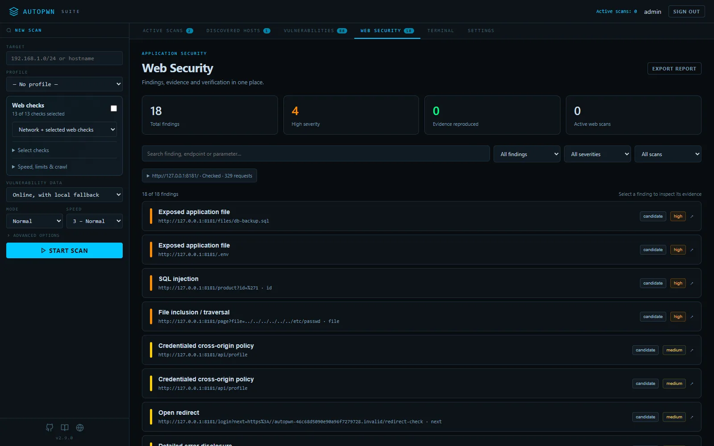
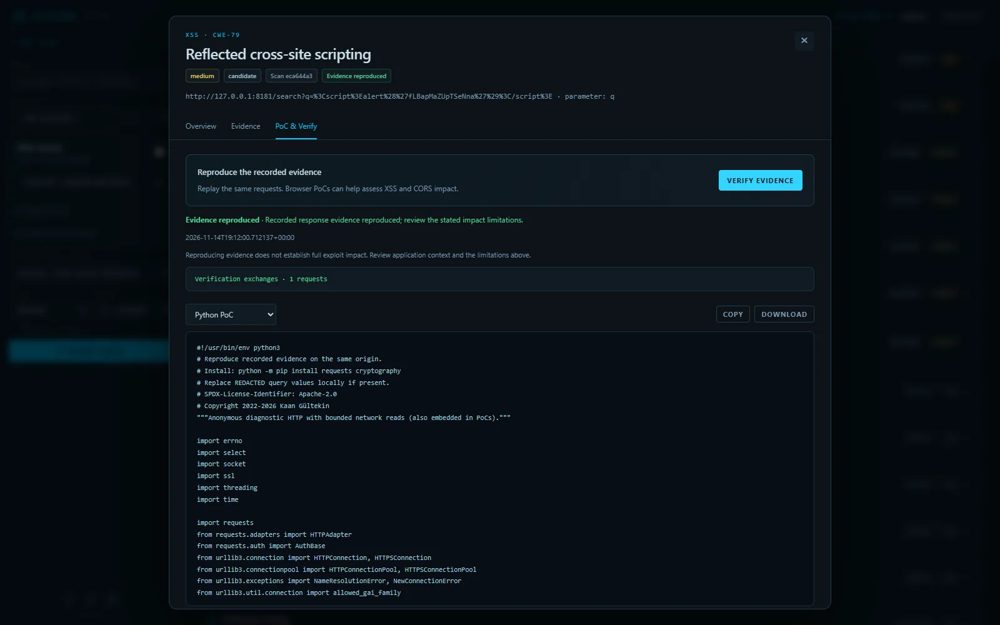
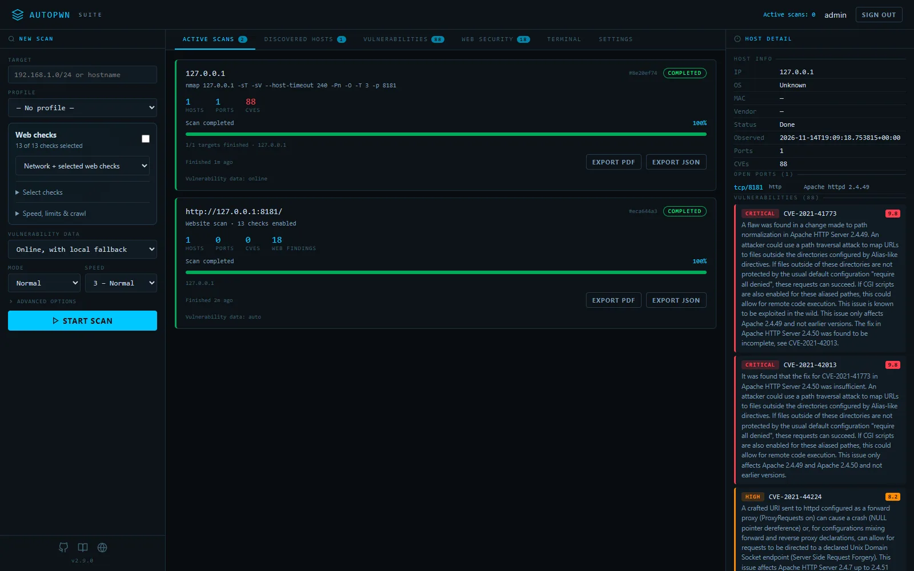
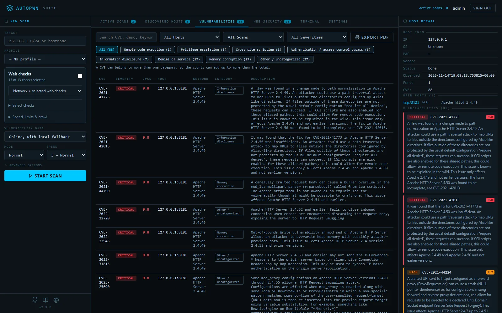
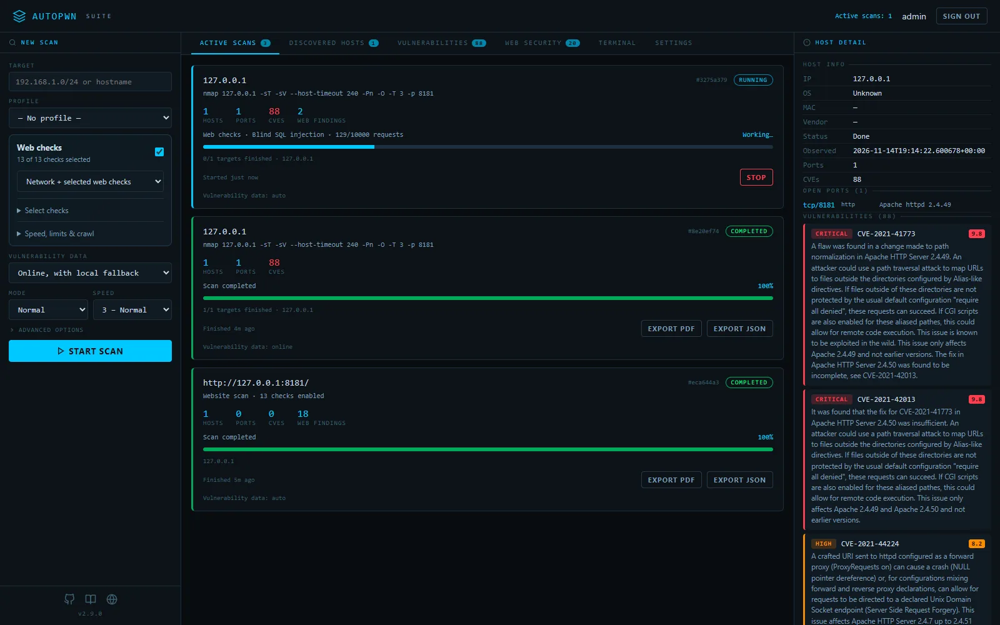
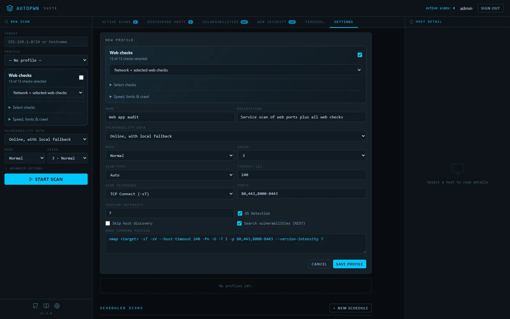

As of November 2026 it has more than 1,150 stars and 146 forks on GitHub,
over 1,090 commits since May 2022, and the
[OpenSSF Best Practices badge](https://www.bestpractices.dev/projects/15518) at
Gold.

## Why it exists

Nearly every CTF box and every internal pentest opens the same way. You run
Nmap, read the service versions it found, look each one up for known
vulnerabilities, then go to Exploit-DB to see whether anyone has published an
exploit. None of that is hard. It is slow, and with forty services on a
network it is easy to skip one.

AutoPWN Suite started in May 2022 as a script that ran that loop for me. The
first commit was a single `main.py`. That October, PenTest Magazine asked me
to write it up for their
[open-source pentesting toolkit issue](https://legacy.pentestmag.com/download/pentest-open-source-pentesting-toolkit/).

Then it went quiet for a while. 2023 has no commits at all, and in 2024 I
mostly kept it alive after NIST retired the old NVD API. It came back in
stages: a daemon mode and a Linux installer in late 2025, the web dashboard in
spring 2026, and then October 2026, when I shipped nine releases in one month.
This page describes where that left it.

## What it does

A full run goes like this:

1. Work out the local network range on its own, or take the target you give it.
2. Find live hosts with an ARP or a ping sweep, depending on whether it has root.
3. Scan each host with Nmap for open ports, service versions and the operating system.
4. Look up the CVEs that apply to each version, live from NIST's National
   Vulnerability Database or from a local copy.
5. Download public exploits for those CVEs from Exploit-DB.
6. Check any web servers it found for common application bugs and misconfigurations.
7. Write a report, and if you want, email it or post it to a webhook.

You can drive it four ways: the `autopwn-suite` command, a web dashboard, a
Python library, or a systemd service that rescans the network on a schedule.
It runs on Linux, macOS and Windows, and since 2.8 it speaks Turkish as well as
English.

An older recording of the command line output:

[](https://asciinema.org/a/509345)

## How it decides something is vulnerable

This is the part I have rewritten the most, and the part that decides whether
the tool is useful or just noisy.

Until 2.9 the lookup was crude. It turned Nmap's product and version into a
search phrase and kept the CVEs whose description contained that exact version.
That misses most real vulnerabilities, because NVD descriptions usually give a
range ("before 2.4.52"). And old advisories that NVD never tied to a version
showed up for every release of the product.

Version 2.9 asks NVD properly:

- **Name the product the way NVD does.** Nmap says `Apache httpd`, NVD says
  Apache HTTP Server. `Samba smbd`, `Exim smtpd` and `MiniServ` become Samba,
  Exim and Webmin. Distribution build suffixes come off the version, so
  `8.2p1 Ubuntu 4ubuntu0.5` is looked up as OpenSSH 8.2p1.
- **Trust the version ranges, not the prose.** A CVE is kept only when NVD's
  applicability data (the CPE configurations) marks that release as vulnerable.
- **Use the CPE Nmap already found.** When Nmap reports one, AutoPWN also
  fetches the CVEs that list that product, which catches the ones whose
  description never names it. That is how HTTP/2 Rapid Reset (CVE-2023-44487)
  shows up for nginx.
- **Only count the right product.** FileZilla Server no longer collects
  FileZilla client CVEs, and an FTP server that Nmap can only tie to Windows
  doesn't inherit every Windows CVE.
- **Don't guess at versions that aren't versions.** `3.X - 4.X`, a bare `4` or
  `2.0.0 or later` names no single release, so it isn't searched at all.

| Nmap reports | AutoPWN looks up |
|---|---|
| `Apache httpd 2.4.49` | Apache HTTP Server 2.4.49 |
| `OpenSSH 8.2p1 Ubuntu 4ubuntu0.5` | OpenSSH 8.2p1 |
| `Jetty 9.4.18.v20190429` | Jetty 9.4.18 |
| `MySQL`, answered by a MariaDB server | MariaDB |
| `Samba smbd 4` | nothing, because `4` is not a release |

It is still a version match, and the documentation says so plainly. A
distribution package with a backported fix is reported as vulnerable, and a
bug in a bundled library that NVD files under another product is missed. A
finding is a lead, not proof, and a clean result doesn't mean a machine is
safe.

### Offline, for networks that can't reach NVD

`--update-vuln-db` downloads NVD's yearly feeds, 2002 to now, into a single
SQLite file. Checksums and record counts are verified before the new copy
replaces the old one, so a failed download never leaves you with a broken
database. Copy that file to an air-gapped machine and `--offline` scans
against it with no internet at all: no NVD, no exploit downloads, no
notifications, only Nmap talking to the targets you named.

## Web checks

When a scan finds a web server, AutoPWN crawls it (same origin only, 250 pages
by default) and checks for path traversal, reflected XSS, SQL injection
(error-based and boolean), exposed files such as `.env` and `.git`, directory
listings, permissive CORS, open redirects, Host header injection, risky HTTP
methods, missing security headers and cookie flags, and TLS problems like
expired certificates or TLS 1.0 still being enabled.

I kept these conservative on purpose, because a scanner that cries wolf gets
ignored:

- A promising probe is repeated, and compared against the page's normal
  response, before anything is reported.
- An XSS payload only counts if it comes back unescaped somewhere a browser
  would run it, in a script element or an event handler. Reflection inside
  JSON or an HTML comment doesn't.
- Findings say what they are. A **candidate** needs a human to confirm it, an
  **observation** is true but not a vulnerability on its own, and an
  **advisory** is configuration you should fix.
- Every endpoint gets a request budget (10,000 by default), probes never leave
  the target's origin, and your own cookies and credentials are never attached.

In the dashboard every finding opens up to its evidence: the baseline request,
the probe, the repeat and what changed between them, along with the likely
impact, the fix, and CWE and OWASP references. You can download a reproducer
as a Python script, curl commands, a browser page (for XSS and CORS) or a JSON
request plan. A **Verify** button replays the recorded requests to see whether
the issue is still there. Viewing or downloading a PoC never touches the
target; only Verify does.

<figure>
  
  <figcaption>The Web Security tab after a scan of a deliberately broken test app on localhost.</figcaption>
</figure>

<figure>
  
  <figcaption>A reflected XSS finding after Verify: the evidence reproduced, and the Python reproducer ready to copy or download.</figcaption>
</figure>

## The dashboard

`autopwn-suite --web` starts it on `127.0.0.1:8080`.

<figure>
  
  <figcaption>Two finished scans of a local test server: a network scan that found an old Apache and matched 88 CVEs, and a website-only scan with 18 findings.</figcaption>
</figure>

From there you can:

- run several scans at once and watch Nmap's output live, with progress for each stage;
- save scan profiles and schedule them every few hours, daily or weekly;
- stop a scan and resume it later without redoing the finished work;
- browse every CVE found, filtered by kind (remote code execution, denial of
  service, information disclosure and so on, worked out from each CVE's CWE),
  as in the screenshot below;
- get an email or a webhook when a scan finishes, fails or finds something;
- check for updates and apply them from Settings.

<figure>
  
  <figcaption>The Vulnerabilities tab. One CVE can fall into more than one category, so the counts add up to more than the total.</figcaption>
</figure>

<figure>
  
  <figcaption>A scan in progress. The bar follows the current stage, here a blind SQL injection check 129 requests into its budget of 10,000.</figcaption>
</figure>

Since 2.7 the dashboard has no box for raw Nmap flags. It builds the Nmap
command from its own controls, so nobody with dashboard access can make Nmap
run scripts or write files on the server. The command line, where you are
already trusted, still takes `--nmap-flags`.

<figure>
  
  <figcaption>The profile editor. Every Nmap option is a control, and the command preview is built from them.</figcaption>
</figure>

## Making it safe to run

A scanner is an awkward thing to secure. It usually runs as root, it spends its
life parsing output from machines that may be hostile, and the dashboard holds
your SMTP password and webhook URLs. In October 2026 I put the code through a
full security review.

The worst finding was also the simplest: version 2.6.0 had no login at all and
listened on every network interface. Anyone who could reach port 8080 could
read your results and settings and launch scans as you. That became
[AUTOPWN-SA-2026-001](https://github.com/GamehunterKaan/AutoPWN-Suite/blob/main/docs/SECURITY_ADVISORIES.md),
and 2.6.1 fixed it the next day.

The review produced 21 advisories in all. Every one is written up in public
with the affected versions, the impact, how to mitigate it, and once it's
fixed, the release that fixed it. Some of what changed because of it:

- The dashboard requires a login. On first start it creates an `admin` account
  with a random password, prints it once and stores only a scrypt hash.
  Sessions expire after eight hours, every state-changing request needs a CSRF
  token and a same-origin `Origin` header, and failed logins are rate limited.
- It listens on localhost by default and refuses plain-HTTP logins from
  anywhere else.
- Anything a target controls (banners, headers, hostnames, certificate names,
  even CVE descriptions) is reduced to a single printable line before it's
  shown, so a hostile server can't forge result lines or send escape codes to
  your terminal.
- Query strings are redacted from logs, exports and notifications, so a token
  in a scanned URL doesn't end up in your inbox.
- Web checks verify TLS certificates unless you pass `--insecure-tls`.

And around the code itself:

- Releases reach PyPI through trusted publishing, artifacts are signed with
  Sigstore, and the standalone binaries are built twice and have to come out
  byte-for-byte identical.
- The Docker image pins its base image by digest and installs only
  hash-pinned dependencies.
- CI runs the test suite, Bandit, CodeQL and an OWASP ZAP scan against a live
  dashboard, and ClusterFuzzLite fuzzes the parsers a pull request touches.

AutoPWN Suite now holds the
[OpenSSF Best Practices badge](https://www.bestpractices.dev/projects/15518) at
Gold, the highest level, and all three OpenSSF Baseline levels.

## Release history

| When | Release | What changed |
|---|---|---|
| May&nbsp;2022 | First commit | A single script that chained Nmap, NVD and Exploit-DB |
| Oct&nbsp;2022 | PenTest Magazine | The AutoPWN Suite entry in their Open-Source Pentesting Toolkit issue |
| Feb&nbsp;2024 | NVD API 2.0 | Lookups moved to NIST's 2.0 API after the old one was retired |
| Oct&nbsp;2025 | Daemon and installer | A systemd service for scheduled scans and a Linux install script |
| Apr&nbsp;2026 | 2.4, the web dashboard | Concurrent scans, live output, profiles, schedules and notifications in the browser |
| 9&nbsp;Oct&nbsp;2026 | 2.5 | The offline vulnerability database, and live progress with cancellation |
| 15&nbsp;Oct&nbsp;2026 | 2.6 | Web security checks with evidence and PoCs, resumable scans, and a native Nmap XML adapter in place of python-nmap |
| 16&nbsp;Oct&nbsp;2026 | 2.6.1 | Dashboard login, localhost by default, TLS verification for web checks |
| 19&nbsp;Oct&nbsp;2026 | 2.7 | Install with pipx or uv from PyPI, standalone binaries, and no raw Nmap flags in the dashboard |
| 21&nbsp;Oct&nbsp;2026 | 2.8 | Turkish, self-update from the command line, and CVE categories |
| 24&nbsp;Oct&nbsp;2026 | 2.8.1 | Update checks and updates from the dashboard's Settings |
| 29&nbsp;Oct&nbsp;2026 | 2.9 | CVE matching through NVD's version ranges and Nmap's CPEs |

The full notes are in the
[changelog](https://github.com/GamehunterKaan/AutoPWN-Suite/blob/main/CHANGELOG.md),
and the [roadmap](https://github.com/GamehunterKaan/AutoPWN-Suite/blob/main/docs/ROADMAP.md)
says what comes next and, just as usefully, what the project won't do.

## Running it

You need Nmap for network scans (the command line offers to install it) and
Python 3.11.5 or newer.

```bash
pipx install autopwn-suite        # or: uv tool install autopwn-suite
autopwn-suite -t 192.168.1.10     # one host you're allowed to test
autopwn-suite -y                  # find the local network and scan all of it
autopwn-suite --web               # the dashboard, on http://127.0.0.1:8080
```

Every release also has single-file binaries for Linux (x64 and ARM), Windows
and macOS that don't need Python, and there's a Docker image:

```bash
docker run -it --net=host gamehunterkaan/autopwn-suite -t 192.168.1.0/24 -y
```

From Python:

```python
from autopwn_suite import AutoScanner

scanner = AutoScanner()
results = scanner.scan("192.168.0.1")
scanner.save_to_file("autopwn.json")
```

On a network with no internet:

```bash
autopwn-suite --update-vuln-db                  # on a connected machine first
autopwn-suite --offline -t 192.168.1.0/24 -y    # then on the isolated one
```

## How the code is laid out

<div class="mermaid">
flowchart LR
    CLI["Command line<br/>cli.py"] --> Scan["scanner.py<br/>nmap_backend.py"]
    API["Python API<br/>api.py"] --> Scan
    Dash["Dashboard<br/>web_ui.py, web_auth.py"] --> Workers["Scan workers<br/>and scheduler"]
    Workers --> Scan
    Scan <--> Targets["Target hosts"]
    Scan --> Lookup["CVE matching<br/>searchvuln.py, cpe_match.py"]
    Lookup <--> NVD["NVD API or<br/>local SQLite mirror"]
    CLI --> Exploits["getexploits.py"]
    Exploits <--> EDB["Exploit-DB"]
    CLI --> Checks["web/ checks"]
    Workers --> Checks
    Checks <--> Sites["Target websites"]
</div>

| Module | What it does |
|---|---|
| `cli.py`, `utils.py` | Read options and config files, run a scan from start to finish |
| `scanner.py`, `nmap_backend.py` | Build Nmap commands, run Nmap without a shell, parse its XML |
| `searchvuln.py`, `nist_search.py`, `cpe_match.py` | Turn services into NVD searches and keep only the CVEs whose version ranges match |
| `vulnerability_db.py` | Download, verify and query the offline NVD mirror |
| `vulnerability_categories.py` | Sort CVEs into categories from their CWE IDs |
| `getexploits.py` | Find and download exploits on Exploit-DB |
| `web/` | The crawler, the web checks, evidence capture, PoC generation and replay |
| `web_ui.py`, `web_auth.py` | The dashboard: REST API, live event stream, scheduler and login |
| `api.py` | `AutoScanner`, for use as a library |
| `update_checker.py` | Update checks, and updates that follow however it was installed |

The repository has the details:
[architecture](https://github.com/GamehunterKaan/AutoPWN-Suite/blob/main/docs/ARCHITECTURE.md),
the [REST API and other interfaces](https://github.com/GamehunterKaan/AutoPWN-Suite/blob/main/docs/INTERFACES.md),
and the [threat model](https://github.com/GamehunterKaan/AutoPWN-Suite/blob/main/docs/THREAT_MODEL.md).

## Thanks, and contributing

AutoPWN Suite has had help.
[iaacornus](https://github.com/iaacornus) contributed nearly a hundred commits
between 2022 and 2024, [qarademir](https://github.com/qarademir) added the
Turkish translation, [codeyevsky](https://github.com/codeyevsky) wrote the
first version of self-update, and others sent fixes along the way.

Pull requests are welcome, and you don't need to open an issue first. Security
problems should go through the
[private reporting channel](https://github.com/GamehunterKaan/AutoPWN-Suite/blob/main/SECURITY.md),
not the issue tracker. For everything else there's the
[issue tracker](https://github.com/GamehunterKaan/AutoPWN-Suite/issues/new/choose).

## License

Since October 2026 AutoPWN Suite is under the
[Apache License 2.0](https://github.com/GamehunterKaan/AutoPWN-Suite/blob/main/LICENSE).
Before that it used a custom license that didn't allow commercial use.

Use it only on systems you are authorized to test. You are responsible for
following the law where you are.
