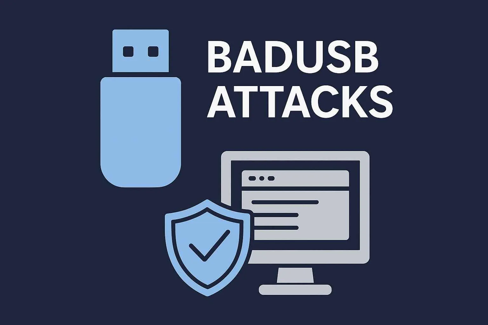

## What these are

These are among the first things I put on GitHub, in January 2022: three short
proofs of concept about USB devices that aren't what they claim to be. They're
small and they're old. I keep them public because the point they make hasn't
aged: a USB device can be far more dangerous than it looks.

This page explains the idea and how to defend against it. It deliberately
doesn't walk through the payloads.

## The idea

When you plug in a USB device, the operating system asks it what it is and
believes the answer. A device that says it's a keyboard is treated as one, and
a keyboard can do anything the logged-in user can do. Other devices pretend to
be a network adapter or a drive. Almost all of these attacks still need
someone to plug the thing in, which is why a USB stick "found" in a car park
keeps working as a trick.

What happens next depends on what the device claims to be:

flowchart LR
  A[Device plugged in] --> B[Host asks what it is]
  B --> C{Device claims to be}
  C -->|Keyboard| D[Typed input the user didn't type]
  C -->|Network adapter| E[A new interface and new traffic]
  C -->|Storage| F[A mounted drive with files on it]
  D --> J[What defenders can see]
  E --> J
  F --> J

## The three proofs of concept

- **[BadUSB-Browser](https://github.com/GamehunterKaan/BadUSB-Browser)** shows
  how little time a keystroke-injecting device needs to reach data that a
  browser keeps on the machine.
- **[BadUSB-Meterpreter](https://github.com/GamehunterKaan/BadUSB-Meterpreter)**
  shows how short the gap can be, in a lab, between plugging something in and
  someone else having a remote session on the machine.
- **[VBSBadUSB](https://github.com/GamehunterKaan/VBSBadUSB)** uses an
  ordinary USB stick rather than special hardware, and makes the case for
  turning off script engines nobody uses any more.

Each is a few dozen lines. They're illustrations for a lab, not tools.

## What defenders can watch for

The useful signal is timing: a device appears and, seconds later, something
happens that a person couldn't have done that fast.

- A new keyboard is enumerated and a shell or script interpreter starts in the
  user's session almost immediately.
- A new network interface appears and the machine starts talking to a host it
  has never talked to before.
- A script engine such as `wscript`, `cscript` or PowerShell starts right after
  a USB device is attached.
- A browser navigates or submits forms with no mouse or touch input behind it.

In practice that means collecting device-attach events (device IDs, device
classes, driver loads) and correlating them with process creation and network
connections in the following 30 to 120 seconds. If an attach lines up with
that kind of activity, isolate the machine and keep the logs.

## Controls that help

- **Device control.** Allow known devices and device classes, and block new
  keyboards and network adapters on machines that matter.
- **Fewer script engines.** Remove or restrict the ones nobody needs.
  Microsoft is phasing VBScript out of Windows, and there's no reason to wait.
- **PowerShell logging.** Script block logging and AMSI make an injected
  command visible after the fact even when it never touched the disk.
- **Egress filtering.** A payload that can't reach the internet has much less
  it can do.
- **People.** Tell staff not to plug in devices they found, and give them
  somewhere to hand them in instead.

## If you want to try them

Only on machines you own, on a network that isn't connected to anything you
care about. That's the whole rule.
